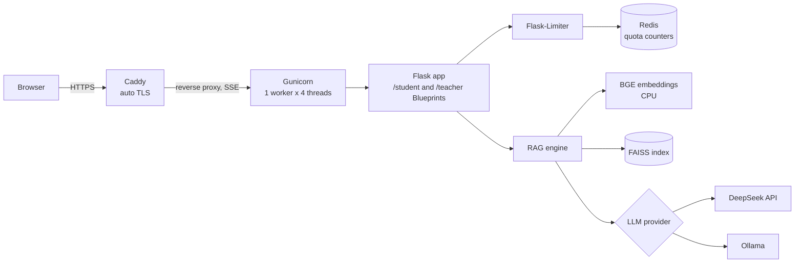

# NutriWise

[](https://github.com/Yimeng0824/NutriWise/actions/workflows/ci.yml)

NutriWise is a retrieval-augmented (RAG) digital textbook for pediatric nutrition. It answers nutrition questions in two voices from the same knowledge base: a playful, emoji-rich explainer for elementary-school students and a rigorous, citation-heavy consultant for teachers. Every answer is grounded in retrieved passages, and claims that come from journal papers are cited with their PubMed IDs.

The system was built as an undergraduate thesis project and piloted with an elementary school (800+ students) on a school-hosted server. This repository contains the production web service, its container setup and its test suite. The knowledge corpus is private (see [Data](#data)).

## Features

- **Weighted retrieval.** BGE (`BAAI/bge-large-zh`) embeddings in FAISS. The retriever over-fetches 2k candidates and keeps up to 4 passages from the expert-written textbook before filling the rest with papers and articles, so the most authoritative source is never crowded out.
- **Two audiences, one core.** Student and teacher services are separate Flask Blueprints (`/student`, `/teacher`) with their own prompts, formatting and temperature, sharing one embedding model and index in memory.
- **PMID-linked citations.** Context passages are labelled by source type and PMID; post-processing renumbers in-text `[文献N]` markers so they stay consecutive and match the reference list.
- **Streaming.** `POST /<role>/api/ask/stream` relays tokens from the upstream LLM as Server-Sent Events, with heartbeats, disconnect handling and a bounded generation budget.
- **Switchable LLM backend.** DeepSeek (OpenAI-compatible API) or a self-hosted Ollama model, selected with one environment variable.
- **Abuse and cost controls.** Per-IP quotas shared across roles and endpoints (Redis-backed in production), a global concurrency cap, request-size limits and an integrity check on the index before it is unpickled.

## Architecture



Gunicorn runs a single worker on purpose: each worker would load its own copy of the 1.3 GB embedding model, so concurrency comes from threads instead. Only Caddy publishes ports (80/443); the app and Redis stay on the internal Docker network.

## Tech stack

Python 3.10 · Flask 3 · Gunicorn (gthread) · LangChain · FAISS · sentence-transformers / PyTorch (CPU) · Flask-Limiter + Redis · Docker / Docker Compose · Caddy · GitHub Actions · pytest · Ruff

## Repository layout

```
serve.py            Flask app factory, Blueprints, SSE endpoint, quotas
engine.py           Shared BGE/FAISS runtime, weighted retrieval, prompt assembly
providers.py        DeepSeek and Ollama adapters (blocking and streaming)
prompts.py          Role prompts and citation post-processing
config.py           Settings loaded only from environment variables
templates/, static/ Student, teacher and landing pages; streaming client
Dockerfile          CPU-only image with pinned PyTorch and BGE weights
compose.yaml        app + Redis + Caddy
Caddyfile           TLS termination and reverse proxy
tests/              Unit and integration tests (no model or network needed)
scripts/            Readiness and public smoke checks
DEPLOY_AWS.md       Step-by-step EC2 deployment guide
```

## Data

The knowledge base combines three sources: a pediatric-nutrition reader co-written with clinical nutrition experts (7 topics), 35 curated articles from medical and health publications, and 610 high-impact journal papers (impact factor ≥ 5) collected from PubMed. The reader and the derived index cannot be redistributed, so `vector_store/` is empty in this repository. [`vector_store/README.md`](vector_store/README.md) documents the expected index format; supply your own index to run the full system.

## Run locally

Requires Python 3.10. PyTorch is installed from the CPU-only wheel index first so that no CUDA packages are pulled in.

```bash
python3.10 -m venv .venv && source .venv/bin/activate
pip install --no-deps torch==2.11.0+cpu --index-url https://download.pytorch.org/whl/cpu
pip install -r requirements-web.txt -r requirements-ml.txt
cp .env.example .env    # then set DEEPSEEK_API_KEY
# place index.faiss, index.pkl and manifest.json in vector_store/
GUNICORN_BIND=127.0.0.1:8080 gunicorn -c gunicorn.conf.py wsgi:app
```

Open http://127.0.0.1:8080/student/ or http://127.0.0.1:8080/teacher/.

## Run with Docker

```bash
cp .env.example .env    # set DEEPSEEK_API_KEY and DOMAIN
docker compose build
docker compose up -d
curl -f https://$DOMAIN/readyz
```

The image installs a pinned CPU build of PyTorch, downloads a pinned revision of the BGE weights at build time, and runs as a non-root user with all Linux capabilities dropped. The API key is injected only at runtime. Caddy obtains and renews a Let's Encrypt certificate for `DOMAIN` automatically.

## Deploy to AWS

See [DEPLOY_AWS.md](DEPLOY_AWS.md) for a complete walkthrough: an EC2 `c7i-flex.large` instance on Ubuntu 24.04, an Elastic IP, a security group that exposes only 80/443, Docker Engine with the Compose plugin, and an `sslip.io` hostname so HTTPS works without buying a domain.

## API

| Method and path | Description |
| --- | --- |
| `GET /`, `/student/`, `/teacher/` | Landing page and the two chat UIs |
| `POST /<role>/api/ask` | JSON in `{"question": "..."}`, JSON out `{"ok", "answer", "sources"}` |
| `POST /<role>/api/ask/stream` | Same input; `text/event-stream` with `token`, `done` and `error` events |
| `GET /healthz` | Liveness; does not load the model |
| `GET /readyz` | Readiness; loads and verifies the model and index |

Quota violations return `429` with `Retry-After`; a full concurrency pool returns `503`; upstream LLM failures return `502` (or an `error` event once a stream has started).

## Tests and CI

The test suite injects a fake vector store and a fake LLM provider, so it needs neither PyTorch nor network access and never spends API credits.

```bash
pip install -r requirements-web.txt -r requirements-dev.txt
pytest -q
ruff check .
```

GitHub Actions runs Ruff and pytest with coverage on every push and pull request. The tests cover weighted retrieval, both Blueprints, greeting and empty-retrieval short-circuits, backend switching, SSE framing and keep-alives, client disconnects releasing concurrency slots, shared per-IP quotas, client-IP handling behind a trusted proxy, safe errors when Redis is unavailable, and empty LLM responses.

## Configuration

All settings come from environment variables (see [.env.example](.env.example)).

| Variable | Purpose |
| --- | --- |
| `LLM_PROVIDER` | `deepseek` or `ollama` |
| `DEEPSEEK_API_KEY`, `DEEPSEEK_BASE_URL`, `DEEPSEEK_MODEL` | Hosted LLM settings |
| `OLLAMA_BASE_URL`, `OLLAMA_MODEL`, `OLLAMA_THINK` | Self-hosted LLM settings |
| `EMBEDDING_MODEL`, `EMBEDDING_REVISION`, `EMBEDDING_DEVICE` | Embedding model, pinned revision, `cpu` or `cuda` |
| `MAX_TOKENS`, `LLM_TIMEOUT` | Output budget and upstream timeout |
| `MAX_CONCURRENT`, `CPU_THREADS` | Global generation slots and Torch threads |
| `ASK_LIMIT`, `RATE_STORAGE_URI` | Per-IP quota and its storage backend |
| `PROXY_HOPS` | Number of trusted reverse proxies (0 or 1) |
| `DOMAIN` | Public hostname for Caddy |

## License

Code is released under the [MIT License](LICENSE). The knowledge corpus is not part of this repository and is not covered by this license.
